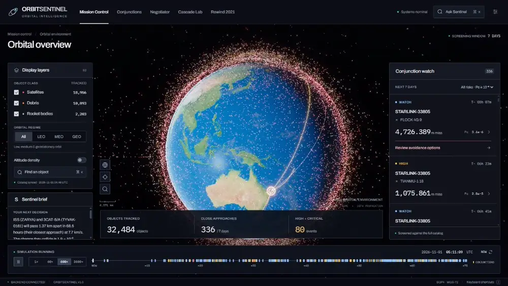
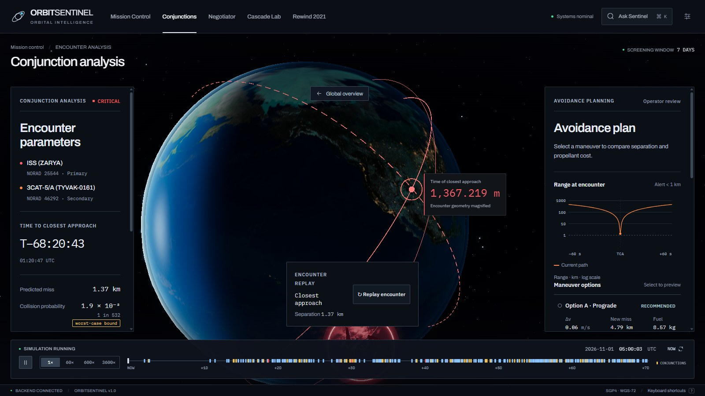
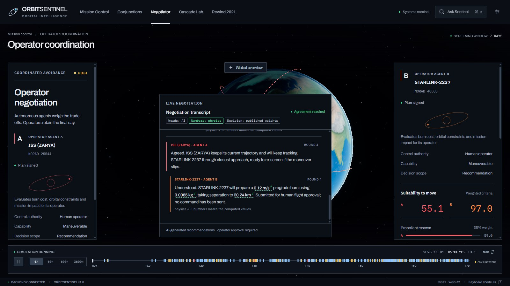
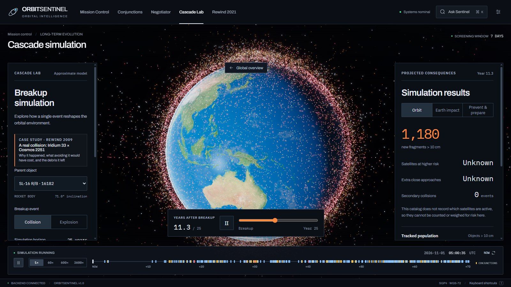
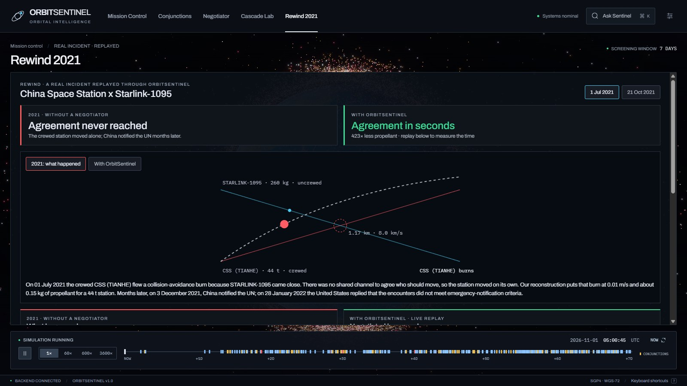
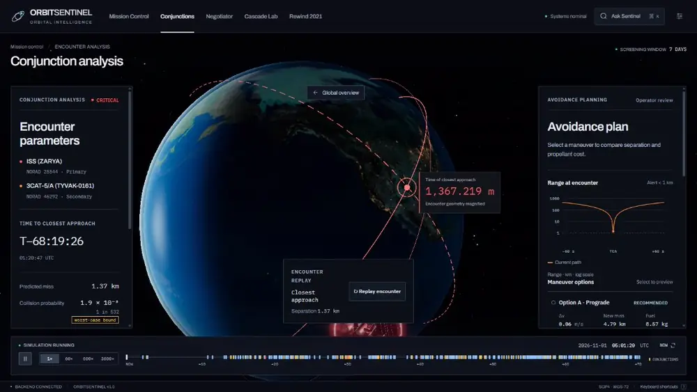
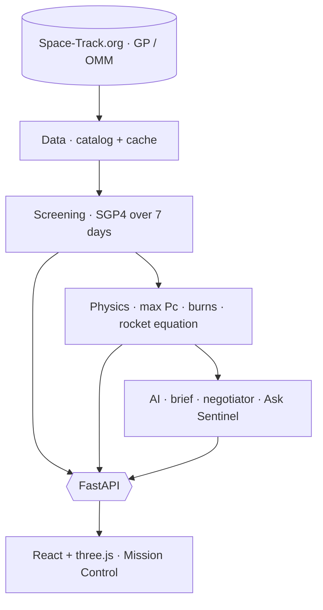

<div align="center">


# OrbitSentinel

### Detection is solved. Decisions aren't.

AI-assisted collision avoidance for satellite operators: live orbital data in, a clear decision out.


<br />



<sub><b>Mission Control</b> · every tracked object propagated with SGP4 on a live 3D globe (simulation at 600×)</sub>

</div>

---

## The problem

Space is getting crowded, and free collision warnings already exist. What operators get, though, is a
raw number with no advice, and when two active satellites are on a collision course there is no
shared way to agree **who should move**. OrbitSentinel turns a warning into a decision: how risky
the encounter is, the cheapest burn that fixes it, and which operator should make it.

<table>
  <tr>
    <td align="center"><b>~32,500</b><br /><sub>tracked objects, refreshed from Space-Track</sub></td>
    <td align="center"><b>7 days</b><br /><sub>SGP4 screening window</sub></td>
    <td align="center"><b>Seconds</b><br /><sub>from alert to an agreed plan</sub></td>
    <td align="center"><b>0</b><br /><sub>invented numbers: every figure is computed</sub></td>
  </tr>
</table>

## What it does

<table>
  <tr>
    <td width="50%" valign="top">
      
      <h4>Conjunction analysis</h4>
      Miss distance, relative speed, RTN offsets, a worst-case collision probability and a replay of
      the encounter, with ranked prograde and retrograde burn options and their fuel cost.
    </td>
    <td width="50%" valign="top">
      
      <h4>AI Negotiator</h4>
      One agent per operator and a mediator decide who moves, scored on propellant reserve, maneuver
      cost, mission impact and delta-v. Every number in the transcript is checked against the physics.
    </td>
  </tr>
  <tr>
    <td width="50%" valign="top">
      
      <h4>Cascade Lab</h4>
      Break up any object and watch the fragment cloud spread, with the extra close approaches it
      would create over the next 25 years.
    </td>
    <td width="50%" valign="top">
      
      <h4>Rewind 2021</h4>
      Real 2021 near misses between the Chinese Space Station and Starlink, replayed to show the
      agreement that never happened, reached in seconds.
    </td>
  </tr>
</table>

### Watch the negotiation

<div align="center">

</div>

### Also inside

- **Sentinel brief**: a 3 to 5 sentence plain-English summary of the riskiest event and what to do.
- **Ask Sentinel**: questions answered only from the computed data, with a deterministic fallback.
- **Mobile alert view** for the on-call operator.
- **Human in the loop**: nothing is ever sent to a spacecraft; an operator approves every maneuver.

## How it works



| Step | What happens |
| --- | --- |
| **Data** | Pulls every on-orbit object from Space-Track.org in OMM format, at most once every 2 hours, and caches it locally or in S3. |
| **Screening** | Propagates the watch-list against the whole catalog with SGP4 and finds every pass inside the screening distance. |
| **Probability** | Public data has no covariance, so it reports the worst-case (maximum) Pc over covariance scale (Alfano 2005). |
| **Maneuvers** | Plans prograde and retrograde burns, estimating fuel with the rocket equation; it recommends a burn only above the NASA CARA red level. |
| **AI** | Writes the brief, runs the negotiation and answers questions, grounded in the computed facts; numbers are validated before display. |

**Stack**: React · TypeScript · Vite · three.js · satellite.js · Python · FastAPI · Pydantic v2 · sgp4 ·
numpy · AWS Lambda (Mangum) · API Gateway · S3 · EventBridge.

## Run it locally

**Backend**

```sh
cd backend
python -m pip install -r requirements.txt
cp .env.example .env        # add SPACETRACK_USERNAME and SPACETRACK_PASSWORD (free account)
python -m app.data.refresh  # download the live catalog
python -m uvicorn app.main:app --port 8000
```

The first screening runs in the background at startup and takes about a minute per watched object.

**Frontend** (Node.js 22.12 or later)

```sh
cd frontend
npm ci
echo "VITE_USE_MOCKS=false" > .env.local
echo "VITE_API_BASE_URL=http://localhost:8000" >> .env.local
npm run dev
```

Skip `.env.local` to run the frontend on built-in sample data with no backend at all.

**Tests**

```sh
cd backend && python -m pytest -q
cd frontend && npm run lint && npm test && npm run build
```

## Honest limits

- Pc is a worst-case bound, because public orbital data carries no covariance.
- "Maneuverable" means an active payload of a known propulsive fleet (Starlink, OneWeb, Kuiper, ISS,
  Tianhe) or an ID in `CATALOG_MANEUVERABLE_IDS`; it is an assumption, not operator-verified.
- Space-Track has no operational status, so other payloads are shown as status unknown.
- OrbitSentinel is a decision aid: it never commands a spacecraft.

More: [frontend guide](frontend/README.md) · [engineering decisions](frontend/DECISIONS.md) ·
[data pipeline](backend/app/data/README.md) · [asset credits](frontend/ASSET_CREDITS.md)

## Contributors

Built for the Anvathon hackathon by Yojith N, Utkarsh Keshri, Yash Mathur and Upendra Singh Gaur.
